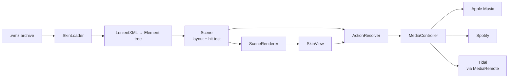

# WMZ Player

**Windows Media Player skins, as a macOS media remote.**

WMZ Player opens the `.wmz` skins people made for Windows Media Player 7–11 and
turns them into a small, shaped window that controls Apple Music, Spotify or
Tidal. The dial, the artwork, the transport buttons, the seek and volume sliders
— they all still work.

It is not a media player and not an emulator. It reads the skin, keeps what it
can render faithfully, and maps the media controls onto the player that is
actually running.

```
 Halo_2.wmz  ──▶  parse WML  ──▶  shaped window  ──▶  AppleScript / Now Playing  ──▶  your player
```

> Bring your own skins. This repository ships no `.wmz` files and no Microsoft
> or third-party artwork.

---

## Features

- **Real skins, not approximations.** Reads the `.wms` definition, background
  layers, tiled subviews and per-control images.
- **Shaped, transparent windows.** The classic transparency-colour trick is
  honoured (`transparencyColor`, and WMP7's `clippingColor`), including artwork
  that uses different keys in different regions.
- **Hit zones from the artwork.** Button groups use the skin's coloured
  `mappingImage`, so an irregular Halo transport cluster behaves like the
  original — not like a bounding box.
- **Working sliders.** Seek and volume read the position map, follow arcs and
  diagonals, and know which way the artwork fills.
- **Live metadata.** Track title, artist and the ten-digit `time1…time4` image
  strips update while the music plays.
- **Panels, like the original.** Playlist, equalizer, visualization and info
  views open as their own windows at the size the skin declares, frame and
  buttons included.
- **A real playlist.** The `<playlist>` control is drawn with the skin's own
  columns and colours and filled from the Music queue; click a row to play it.
- **The skin's own script runs.** A JavaScriptCore host implements WMP's object
  model, so skins that build themselves at runtime — Batman Begins, 9 Series
  Default — lay out, animate and respond as designed.
- **Animated GIFs and click sounds.** Multi-frame artwork animates at its own
  rate, honours play-once animations, and `theme.playSound` effects play.
- **A real visualizer.** `<effects>` panes show FFT output from the player's own
  audio (CoreAudio process tap, macOS 14.2+); the skin's effect buttons cycle
  four shapes — bars, wave, spikes and dots — and the effect name label follows.
- **The whole button map:** transport, mute, shuffle/repeat, volume, seek,
  panel open/close, file picker, URLs, close and minimize.
- **Desktop manners.** Drag a `.wmz` onto the window, keep a library in
  `~/Library/Application Support/WMZPlayer/Skins`, and windows remember where
  you left them. The Dock menu lists recent skins.
- **Apple Music, Spotify and Tidal**, chosen automatically or pinned in the menu.
- **Double size, always-on-top, draggable** from anywhere that is not a control.
- **A CLI for skinsmiths**: inspect a skin, render it offscreen, or ask what a
  click at a coordinate would do.

## Requirements

- macOS 13 or newer
- Xcode command line tools (Swift 6)

## Install

There is no notarised binary yet. [Release v0.3.1-alpha](https://github.com/AlbertSmit/wmz-player/releases)
has a zipped build; because it is ad-hoc signed, macOS quarantines it. Either
right-click the app and choose **Open**, or clear the flag once:

```sh
xattr -dr com.apple.quarantine /Applications/WMZPlayer.app
```

Or build it yourself:

```sh
git clone https://github.com/AlbertSmit/wmz-player.git
cd wmz-player
./scripts/build-app.sh
open dist/WMZPlayer.app --args ~/Downloads/Halo_2.wmz
```

The script produces `dist/WMZPlayer.app` and copies the `wmz` CLI into the
bundle.

On first use macOS asks for permission to control Apple Music or Spotify.
Without that permission those two players cannot be driven.

## Using a skin

| Action | How |
| --- | --- |
| Open a skin | Double-click the `.wmz`, **File → Open Skin…** (`⌘O`), drag it onto the window, or pick from **File → Skins** |
| Play / pause | Click the skin's button, or press **Space** |
| Seek | Drag the skin's seek control, or press **← / →** |
| Volume | Drag the skin's volume control, or press **↑ / ↓** |
| Move the window | Drag any non-control part of the skin |
| Open a panel | The skin's own button, or **Panels** in the menu |
| Play a track | Click a row in the playlist panel |
| Scroll the playlist | Scroll wheel over the list |
| Visualizer | **Window → Visualizer (audio bars)** |
| Menu | Right-click / control-click the skin |
| Player choice | **Player → Automatic / Apple Music / Spotify / Tidal** |
| Size and stacking | **Window → Double Size**, **Always on Top** |

The last skin is remembered.

## Players

| Player | Transport | Track info | Volume |
| --- | --- | --- | --- |
| Apple Music | AppleScript | yes | app volume |
| Spotify | AppleScript | yes | app volume |
| Tidal | macOS Now Playing | best effort | system output volume |

Tidal has no AppleScript dictionary, so it is driven through the same private
`MediaRemote` channel the media keys use. Sending commands works everywhere;
**reading** the now-playing title/artist/position is restricted to Apple-signed
processes on recent macOS. Where the read is allowed (macOS 15.3 and earlier),
Tidal shows full metadata. Where it is not, the skin still plays, pauses, skips
and stops, but the title area stays empty and the seek slider is inert.

`Automatic` picks whichever of the three is actually playing.

## Command line

`wmz` is built alongside the app:

```sh
wmz inspect  <skin.wmz>                  # views, controls, resolved actions
wmz render   <skin.wmz> --out preview.png
             [--scale 2] [--on 202020] [--view <id>] [--playing] [--spectrum]
wmz hit      <skin.wmz> --at 230,190 [--view <id>]
wmz media    [--target music|spotify|tidal|auto] [--seconds <n>]
             [--bundle <fragment>]       # read any app through Now Playing
wmz queue    [--center <index>]          # current queue, or page around a row
wmz audio    [--bundle com.apple.Music]  # live FFT bands (visualizer input)
```

`render --on <hex>` fills the background first, which is the only sane way to
look at skins with large transparent areas. `inspect` prints the resolved
geometry tree, with the image and key colour of each node.

`wmz hit` is the quickest way to debug a control without clicking:

```console
$ wmz hit Halo_2.wmz --at 230,190 --playing
action pause on buttongroup

$ wmz hit Halo_2.wmz --at 242,70 --playing
slider seek = 94% on seek
```

## How a skin is read

A `.wmz` is a ZIP containing a `.wms` definition plus bitmaps. The definition is
XML — but written for WMP's forgiving parser, not for a strict one. Roughly a
third of the archived skins fail `NSXMLParser`, so `LenientXML` handles missing
spaces between attributes, duplicate attributes, unquoted values, bare
ampersands and ANSI encodings.

The renderer supports the parts that carry the look of a skin:

| Area | What is understood |
| --- | --- |
| Layout | `<view>` / `<subview>` with `left`/`top`/`width`/`height`, alignment, `zIndex`, and the arithmetic subset of `jscript:` used for layout (`view.width-43`) |
| Artwork | `backgroundImage` (plain and tiled), `backgroundColor`, transparency keying |
| Controls | `<button>` normal/hover/down states, `<buttongroup>` with `mappingImage` zones |
| Sliders | `<customSlider>` sprite strips; direction fitted from the artwork |
| Playlist | `<playlist>` columns, colours and status line, filled from Music's queue |
| Effects | `<effects>` shows album art, or one of four FFT shapes when the visualizer is on |
| Animation | multi-frame GIF artwork plays at the file's own frame rate |
| Script | the view's `scriptFile` runs in JavaScriptCore against a WMP-shaped object model |
| Text | font, size, colour, justification, `wmpprop:` bindings, title/artist/time |
| Video | `<video>` becomes the current track's artwork |

Commands are resolved in order: the skin's own `onClick` handler (run in the
script host), then the semantic element (`playelement`, `nextelement`, …), then
the `onClick` text parsed as a command, then the control's id or image name
(`m_pause_no.png`).

### The script host

Each view gets a `JSContext` with the skin's globals: every element id is a
global object with `left`/`top`/`width`/`height`/`visible`/`alphaBlend`/`value`/
`backgroundImage`/`image`/`toolTip`, plus `alphaBlendTo` and `moveTo` (animated
at 30 fps). `player`, `theme`, `view`, `eq` and `mediacenter` mirror WMP's
objects: transport, volume/mute/shuffle/repeat, item info, preferences, panel
navigation, sounds and the file dialog. `onLoad`, `onTimer`, `onClick`,
`onMouseOver/Out`, `onKeyPress` and the player state-change handlers all fire;
APIs are matched case-insensitively because skins are inconsistent about it.

Element properties set by the script override the XML: visibility is evaluated
at draw time, artwork and text can be swapped per frame, and moves carry their
subtree with them. A 2-second execution cap keeps a broken skin from wedging the
main thread.

AppleScript drives Music and Spotify. Writes to the player (seek, volume) are
coalesced: Music can apply overlapping `set` events out of order and drop the
newer one.

## Compatibility

Tested against the 175-skin Windows Media Player archive: **171 load and
render**. The four failures are three Windows installers that were distributed
with a `.wmz` extension and one damaged ZIP.

Skins that build their interface from JScript at runtime — Batman Begins is the
clearest example — now lay themselves out and animate through the script host.
Where a skin needs an API we only stub, it degrades to its static parts.

### Known limits

- The script host implements the common WMP API, not all of it: playlist column
  APIs are stubs, and unsupported calls are logged and ignored.
- Skins that rely on WMP's hidden `controlView` polling navigate through a
  fallback in the app; preference handshakes that need real cross-view state may
  still differ.
- Each view has its own JS context. Element ids are shared through a registry,
  but variables declared by one view's script are not visible to another's.
- A few skins reference ids or helpers that do not exist in their own package;
  those handlers throw once and the rest of the skin keeps working.
- The playlist pages in another window of rows near the edges and caches the
  last few windows, so reversing direction is instant; it is not an endless
  virtual list.
- Tidal's metadata and seeking depend on the macOS build (see [Players](#players)).
- Only Music exposes a queue; Spotify and Tidal show the now-playing row.
- The equalizer panel renders and reacts, but cannot process another app's audio
  without a virtual audio device in the signal path.
- The visualizer needs macOS 14.2+ (CoreAudio process taps); on older systems
  `<effects>` keeps showing album art.
- The renderer is intentionally a subset of WMP's UI vocabulary. If a skin looks
  wrong, `wmz inspect` will usually show why.

## Architecture



```
Sources/WMZKit/          engine
  SkinLoader.swift       unpack .wmz, find .wms
  WML.swift              element tree + encodings
  LenientXML.swift       tolerant XML scanner
  Expression.swift       jscript layout arithmetic
  Scene.swift            layout, slider geometry, hit testing
  SceneRenderer.swift    drawing
  SkinAssets.swift       images, transparency keying, sprite frames
  PlaylistLoader.swift   Music queue + shuffle/repeat/file open
  ActionResolver.swift   WMP commands → MediaAction
  MediaController.swift  AppleScript backends
  JavaScriptHost.swift   JavaScriptCore host + WMP object model
  AudioSpectrum.swift    CoreAudio process tap + FFT bands
  SpectrumRenderer.swift visualizer drawing
  SystemNowPlaying.swift MediaRemote bridge + Tidal
Sources/WMZPlayer/       AppKit app (window, menu, input)
Sources/wmz/             CLI
Resources/AppIcon.icon   Icon Composer source for the app icon
scripts/build-app.sh     .app bundle
scripts/make-icon.swift  .icon → .icns
```

## Development

```sh
swift build                 # engine + app + CLI
swift test                  # 66 layout, XML, action and hit-testing tests
swift build -c release
./scripts/build-app.sh      # bundle in dist/
./scripts/skin-sweep.sh     # compatibility table, launches headless
swift scripts/make-icon.swift Resources/AppIcon.icon Resources/AppIcon.icns
```

Useful probes while working on a skin:

```sh
wmz inspect skin.wmz | less
wmz render skin.wmz --out skin.png --on 202020 --scale 2
open skin.png
```

The app also accepts hidden test flags: `--click x,y`, `--drag x1,y1,x2,y2`,
`--panel <id>` and `--panel-click x,y` (coordinates in skin pixels), which drive
the same code path as a real mouse event. `--headless` launches without taking
focus or drawing on screen — `skin-sweep.sh` uses it so compatibility runs never
interrupt you. `WMZ_DEBUG_NP=1` logs what MediaRemote can see on your machine.

## License

MIT — see [LICENSE](LICENSE). Not affiliated with Microsoft. Windows Media
Player and any skins you load remain the property of their respective authors.
